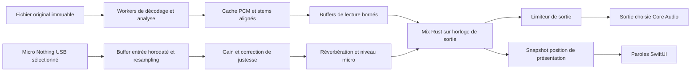

# Karaok Party — Spécifications techniques

Ce document définit une application de karaoké **macOS, gratuite et open source**, dont le moteur audio temps réel est écrit en **Rust**. Le microphone principal est celui du **Nothing Headphone (a) connecté en USB-C**. Son entrée est détectée par macOS ; la capture effective reste à valider. L’application lit des fichiers locaux, prépare leur accompagnement et leurs paroles avant lecture, puis traite la voix live avec correction de justesse et réverbération.

**La musique pilote les paroles.** Le fichier musical, et non la voix de l’utilisateur, détermine la progression. Le premier départ du chant est recherché dans l’enregistrement original pendant la préparation. Les autres phrases doivent ensuite être alignées individuellement : détecter une première voix ne suffit pas à synchroniser une chanson entière.

**État réel au 23 novembre 2026 :** conception documentaire uniquement. Aucun casque Nothing testé, aucun moteur construit, aucune mesure de latence, aucun modèle évalué sur un corpus du projet. Les valeurs numériques ci-dessous sont des objectifs de conception ou de recette, jamais des résultats acquis. Les sources ont fait l’objet d’une recherche ciblée ; elles ne constituent pas un audit exhaustif des projets référencés.

Le dépôt de référence est [danyvassily/karaok-](https://github.com/danyvassily/karaok-). Le [MASTER_PROMPT.md](MASTER_PROMPT.md) décrit la méthode de travail des agents ; ce document reste la référence du comportement produit.

## 1. Portée, vocabulaire et règles de lecture

### 1.1 Direction retenue

Le parcours principal est entièrement sur Mac : sélectionner les périphériques, importer un morceau, préparer les pistes et les paroles, vérifier les passages incertains, chanter. Aucun compte de service musical n’est requis. Le style de paroles « façon Spotify » désigne une présentation lisible et fluide ; il n’implique aucune connexion à Spotify.

Les pistes précédemment envisagées de micro iPhone, app iOS, QR code, Safari microphone, WebRTC et serveur de signalisation sont **hors périmètre**. Elles ne sont ni une dépendance cachée, ni un jalon, ni une solution de repli. Le duo n’est plus une exigence bloquante. Une extension ultérieure pourrait gérer deux entrées audio du Mac, après validation de leurs horloges et de leur routage.

**Constat matériel communiqué au projet le 23 novembre 2026 :** l’inventaire en lecture seule `system_profiler` expose le modèle **Nothing Headphone (a)**, fabricant **Nothing Tech**, transport **USB**, avec une entrée mono (1 canal) à **48 000 Hz** et une sortie stéréo (2 canaux) à **48 000 Hz**, sous deux entrées d’inventaire distinctes. Ce n’est ni un test de capture, ni une mesure de qualité/latence, ni une preuve d’autorisation microphone. Aucun réglage système n’a été modifié. Le casque n’était pas l’entrée système par défaut : sélectionner son entrée explicitement dans l’app et laisser les défauts globaux inchangés.

Le branchement jack 3,5 mm observé auparavant n’exposait qu’une sortie « Écouteurs externes », sans entrée Nothing. L’app ne peut pas créer un micro absent. Ce cas reste une recette de diagnostic ; l’USB-C est désormais la configuration de référence. Ne pas confondre Headphone (a) avec Headphone (1) ou un modèle CMF. Les identifiants personnels de l’inventaire ne sont pas publiés. Le modèle du Mac et la version exacte de macOS restent à relever pour les benchmarks.

### 1.2 Statuts utilisés

| Terme | Signification |
|---|---|
| **Exigence ferme** | Demande utilisateur à conserver. Une difficulté exige un blocage explicite ou un arbitrage, pas une suppression discrète. |
| **Décision de conception** | Choix recommandé pour engager le développement ; révisable avec preuve, impact et mise à jour du journal. |
| **Hypothèse** | Condition non vérifiée, à tester avant de la transformer en promesse. |
| **Cible** | Seuil proposé pour guider les essais. Une cible non atteinte ne peut être présentée comme satisfaite. |
| **Mesure** | Résultat accompagné d’un protocole, du matériel, des versions, des données et d’un artefact consultable. |
| **Extension** | Fonction intéressante, sans droit de retarder ni de remplacer les exigences fermes. |

V1 désigne la première version fonctionnelle répondant aux exigences P0 ci-dessous. Des prototypes et préversions peuvent être incomplets, avec leurs limites visibles. Une interface de démonstration seule n’est pas une V1.

### 1.3 Glossaire

- **PCM** : échantillons audio décodés. **DSP** : traitement numérique du signal.
- **Stem** : piste issue d’une séparation, par exemple voix originale ou accompagnement.
- **Voix originale** : voix du fichier musical ; **voix live** : signal provenant du microphone sélectionné. Ces deux gains sont indépendants.
- **HAL/Core Audio** : couche matérielle audio de macOS et ses API. **UID** : identifiant de périphérique persistant fourni par le système ; distinct de son nom et de l’identifiant numérique temporaire.
- **Callback temps réel** : fonction appelée par le système pour fournir ou recevoir un bloc audio avant une échéance. Elle ne doit pas attendre une opération lente.
- **Monitoring logiciel** : retour de la voix traitée vers la sortie. Ce n’est pas le retour matériel direct éventuellement proposé par un casque ou une interface.
- **F0** : fréquence fondamentale de la voix ; **formants** : caractéristiques de l’enveloppe spectrale contribuant au timbre.
- **VAD** : détection d’activité vocale, souvent conçue pour la parole ; elle ne prouve pas la présence de chant ni le texte chanté.
- **Alignement forcé** : association d’un texte connu à des positions dans l’audio ; distinct de la transcription qui propose le texte.
- **Timeline source** : positions dans le fichier original décodé, intro comprise. **Timeline de présentation** : ce qui est entendu à la sortie à un instant donné.
- **FFI** : frontière entre langages. **ADR** : décision d’architecture argumentée. **p95/p99** : percentiles de distributions mesurées.

## 2. Exigences et priorités

Tous les identifiants sont stables. Le tableau donne les principaux critères de recette, détaillés en section 16.

| ID | Priorité | Comportement exigé | Recette |
|---|---|---|---|
| REQ-001 | P0 | Application macOS gratuite et open source ; moteur temps réel Rust ; frontière des autres langages explicite. | AC-01, AC-22 |
| REQ-002 | P0 | Micro Nothing comme choix principal lorsqu’il existe en entrée ; sélection visible ; aucun remplacement silencieux par le micro intégré. | AC-02, AC-04 |
| REQ-003 | P0 | Inventaire de toutes les entrées/sorties audio exposées à l’app, listes séparées, capacités et valeurs réellement utilisées. | AC-02 |
| REQ-004 | P0 | Sélection fixe ou rôle système par défaut, changement à chaud, disparition, renommage, réapparition et erreurs traités. | AC-03, AC-04 |
| REQ-005 | P0 | Gain, mute, indicateur de niveau et d’écrêtage, test micro ; retour logiciel désactivable et sûr. | AC-05 |
| REQ-006 | P0 | Import MP3/WAV non protégés ; original conservé ; métadonnées et détection de doublons. | AC-06 |
| REQ-007 | P0 | Bibliothèque locale, recherche, favoris, playlists ordonnées et édition des informations. | AC-06, AC-18 |
| REQ-008 | P0 | Préparation du fichier avant le karaoké : séparation, activité chantée, premier départ, reprises, préparation du minutage. | AC-07, AC-08 |
| REQ-009 | P0 | Voix originale séparée et accompagnement réglables indépendamment du micro ; cache persistant. | AC-07, AC-12 |
| REQ-010 | P0 | Saisie/collage des paroles, import de paroles minutées, correction manuelle des phrases et décalage global. | AC-09, AC-10 |
| REQ-011 | P0 | Texte minuté adapté à la version prioritaire ; sinon alignement offline du texte ; transcription seulement proposée et révisable. | AC-08, AC-09 |
| REQ-012 | P0 | Quatre ou cinq blocs de paroles, actif identifiable, suivants visibles, défilement fluide, plein écran. | AC-10, AC-20 |
| REQ-013 | P0 | Paroles asservies à la timeline musicale malgré silence live, pause, seek et reprise ; aucune progression inventée au mot. | AC-10, AC-11 |
| REQ-014 | P0 | Vraie correction de justesse live : F0, notes cibles/tonalité, confiance, transition et gestion non-voisé. | AC-13 |
| REQ-015 | P0 | Réverbération live, intensité/wet-dry, bypass ; Naturel/Studio/Scène ; gains et protection contre l’écrêtage. | AC-14 |
| REQ-016 | P0 | Dérive entre entrée et sortie traitée ; conversion de fréquences ; latence décrite et mesurée par configuration. | AC-15, AC-16 |
| REQ-017 | P0 | Préparation asynchrone, annulation, reprise aux points persistés, cache invalidé selon fichier/modèle/texte/paramètres. | AC-17 |
| REQ-018 | P0 | Utilisation locale sans abonnement Apple Developer imposé pour compiler/tester ; installation et permissions documentées. | AC-01, AC-19 |
| REQ-019 | P0 | Données locales, aucun envoi audio automatique, accès réseau facultatif, aucune collecte vocale cachée. | AC-19 |
| REQ-020 | P0 | UI sobre et accessible ; erreurs actionnables ; disponibilité réelle distincte de l’état de préparation. | AC-20, AC-21 |
| REQ-021 | P0 | Contrôles de qualité/licences du DSP et des modèles ; aucune fonction factice présentée comme achevée. | AC-13, AC-22 |
| REQ-022 | P1 | Transposition de la tonalité du morceau pour la tessiture, distincte de la correction du micro. | AC-23 si livrée |
| REQ-023 | Extension | Tempo indépendant, boucle entraînement, enregistrement/réécoute, queue de chanteurs, double écran, télécommande. | Recette dédiée avant activation |
| REQ-024 | Investigation | Spotify/YouTube facultatifs, isolés et soumis à validation de faisabilité et de règles. | AC-24 |

**P0 ne signifie pas « tout réaliser dans un seul changement ».** Les jalons isolent les risques. La correction de justesse, l’analyse avant lecture et le micro Nothing ne peuvent être déplacés en extension pour déclarer plus tôt la V1 terminée.

## 3. Parcours et interface

### 3.1 Premier lancement et réglage du son

1. Afficher une bibliothèque vide avec « Importer un morceau » et une zone « Son » immédiatement accessible.
2. Demander l’accès au microphone lorsque l’utilisateur choisit « Tester mon micro » ou active le chant, avec une explication en français. La lecture de fichiers reste disponible en cas de refus.
3. Afficher séparément **Entrée microphone**, **Sortie musique et mix** et **Retour de ma voix**. Le retour est un interrupteur et un niveau vers la sortie sélectionnée en V1, pas la promesse d’un troisième périphérique indépendant.
4. Repérer les noms pouvant correspondre à Nothing comme suggestions, jamais comme preuve d’identité. L’utilisateur confirme le périphérique ; son UID est mémorisé. S’il est absent, afficher « Micro préféré indisponible » et proposer la sélection, sans activer le micro Mac.
5. Afficher le niveau pré-effets, la saturation d’entrée et le niveau post-effets. Le gain logiciel ne répare pas un signal déjà écrêté dans le convertisseur ou le casque.
6. Proposer un court test de monitoring avec volume modéré, temporisé et arrêt visible. Aucun enregistrement durable implicite. Si un test par enregistrement est ajouté, obtenir une action explicite et indiquer sa suppression.

Une sortie vers haut-parleurs et un micro proche peuvent produire du larsen. Garder le retour désactivé au premier lancement et après changement de route à risque. Le limiteur évite certains dépassements numériques mais ne constitue pas une protection acoustique garantie.

### 3.2 Import et préparation

Le dépôt d’un MP3/WAV ou la sélection par boîte de dialogue crée une entrée de bibliothèque. L’app détecte le format réel, copie l’original dans la bibliothèque gérée par défaut, calcule son empreinte et lit ses métadonnées. Une option future de fichier référencé ne doit pas remplacer la copie sans expliquer les risques de déplacement.

La fiche présente « Original prêt », puis les étapes **Séparation**, **Repérage du chant**, **Synchronisation des paroles**, **Vérification**. Les résultats déjà en cache sont réutilisés. Afficher une progression par étape réellement observable ; une estimation de durée porte le mot « estimée ». Une animation seule ne doit pas afficher un faux pourcentage.

L’utilisateur peut écouter l’original pendant une préparation si les ressources le permettent. Le bouton « Chanter avec accompagnement et paroles synchronisées » n’affirme pas que des fonctions indisponibles sont prêtes. Un mode « Écouter l’original » ou « Chanter avec paroles non minutées » est un choix explicite de dégradation, pas la validation de REQ-008/011.

### 3.3 Vérifier les paroles

Priorité à un fichier minuté correspondant à cette édition du morceau. Sinon l’utilisateur colle son texte, puis lance son alignement sur la voix séparée. Une transcription facultative peut proposer un brouillon si le texte manque. Les mots absents ou incertains restent signalés ; l’app n’en invente pas pour combler les trous.

Afficher une mini-timeline avec début du chant détecté, segments vocaux, blocs de paroles et zones à vérifier. Permettre écouter autour d’un repère, déplacer début/fin d’une ligne, marquer une plage instrumentale, corriger le texte et régler un décalage global. « Valider » enregistre une révision, sans écraser les mesures ni la provenance initiales.

Une ligne ajoutée à la main n’obtient pas automatiquement un temps. Un clic « placer la ligne ici » est une annotation humaine ; il ne doit pas être compté comme une réussite du modèle. Une version live, radio ou remix nécessite une vérification indépendante.

### 3.4 Chanter

L’écran principal laisse dominer les paroles. Il contient le titre, la progression, lecture/pause, plein écran et trois volumes nettement nommés : **Accompagnement**, **Voix originale**, **Mon micro**. Le panneau des effets est repliable ; ses contrôles principaux sont le préréglage, la correction de justesse, la réverbération et le retour de voix.

Par défaut, afficher cinq blocs logiques : un précédent, le bloc actif et trois suivants lorsque disponibles. Sur une petite fenêtre ou avec un texte agrandi, passer à quatre plutôt que tronquer le texte. Une phrase peut occuper plusieurs lignes typographiques : « cinq blocs » n’oblige pas à afficher cinq phrases longues hors écran. Les blocs à venir doivent rester suffisamment contrastés pour anticiper.

L’intro est conservée. Avant la première phrase, indiquer « Introduction » et éventuellement un compte à rebours fondé sur un repère validé. Dans un solo instrumental, aucune phrase passée ne doit rester artificiellement active. Au silence du chanteur live, la musique et les paroles continuent normalement.

### 3.5 Direction visuelle et accessibilité

Décision : interface macOS native soignée, fond calme, typographie généreuse, hiérarchie claire, accent unique, animations courtes. Éviter les tableaux de bord encombrés, vumètres décoratifs et effets visuels qui gênent la lecture. Les couleurs A/B d’un duo ne font pas partie de la V1.

- Cible de contraste : 4,5:1 pour le texte courant, 3:1 pour le grand texte et les contrôles essentiels ; vérifier les couleurs réelles.
- La ligne active se distingue par poids/position et pas seulement par couleur. Les avertissements comportent du texte.
- Respecter Réduire les animations et les préférences d’accessibilité ; proposer une transition sans défilement animé.
- Navigation clavier complète, focus visible, libellés VoiceOver, valeurs/unités des curseurs, pas d’annonce vocale à chaque frame.
- Espace lecture/pause hors édition de texte, Échap sort du plein écran, raccourcis affichés et personnalisables ultérieurement.
- Taille de texte réglable ; test à 200 %, textes longs, accents, apostrophes, japonais et langues de droite à gauche. Ne pas couper une syllabe pour préserver une maquette.

### 3.6 Erreurs et reprise

| Situation | Réaction attendue |
|---|---|
| Permission micro refusée/révoquée | Micro arrêté, raison et chemin vers Réglages Système ; lecture et bibliothèque utilisables. |
| Casque perdu | Mute immédiat de sa contribution, statut indisponible, aucune nouvelle entrée activée silencieusement. |
| Sortie perdue | Pause et arrêt progressif du rendu ; proposer une sortie. Aucun basculement surprise sur haut-parleurs. |
| Capacités Bluetooth modifiées | Relire capacités, reconstruire la route, montrer le format réellement actif et une explication contextuelle. |
| Format illisible/DRM | Refuser proprement avec nom du fichier et cause exploitable ; aucun contournement. |
| Modèle manquant, hors ligne | Conserver l’original, expliquer le téléchargement requis et proposer l’import d’un modèle autorisé ; ne pas simuler l’analyse. |
| Alignement peu fiable | Montrer les segments à corriger, autoriser minutage manuel ; pas de badge « synchronisé » injustifié. |
| Disque plein/crash d’analyse | Garder les étapes terminées et l’original ; état d’erreur récupérable, nettoyage des temporaires possédés par l’app. |

## 4. Architecture recommandée

### 4.1 Décisions et alternatives

**Décision D-001 : SwiftUI pour l’interface macOS, Rust pour le domaine, le transport de lecture et le DSP temps réel.** SwiftUI est du Swift, pas du Rust. Un adaptateur natif gère fenêtres, permissions, sélecteurs de fichiers et intégration système. Une ABI C étroite relie le moteur Rust à cette interface. Cette combinaison répond à la cible Mac et à la qualité d’interface sans déplacer le moteur sur le thread graphique.

**D-002 : Core Audio comme autorité matérielle.** Évaluer CPAL pour ouvrir les flux Rust ; compléter son abstraction par le HAL C pour les propriétés/listeners qui seraient nécessaires dans la version retenue. Ne pas ouvrir deux fois la même route avec deux backends concurrents. Un seul module possède le cycle de vie I/O. Le prototype détermine s’il faut CPAL avec complément HAL ou un adaptateur HAL direct. Les API Swift Core Audio récentes ne sont pas imposées sans contrôle de disponibilité SDK/OS. [Sources S01–S04, S07]

**D-003 : analyse batch locale dans un worker séparé du rendu.** Le moteur consomme des artefacts validés. Préférer un runtime embarqué reproductible ; ONNX Runtime est candidat lorsque le modèle et sa conversion sont démontrés compatibles. Un environnement Python isolé peut servir aux expériences, mais demander à chaque utilisateur de gérer Conda n’est pas l’installation cible.

| Option | Évaluation et décision |
|---|---|
| Tauri + React + Rust | Alternative crédible si l’audit OpenKara prouve un gain substantiel. React/TypeScript reste une couche UI ; aucun DSP dans le WebView. Pas de migration vers cette option sans ADR. |
| Fork complet OpenKara | Candidat à auditer, pas choix acquis. Son README décrit déjà bibliothèque, stems et paroles ; cela ne prouve pas la prise en charge du Nothing et de la correction live demandée. Un fork conserve ses obligations AGPL et l’entretien des écarts. |
| SwiftUI + AVAudioEngine pour tout le DSP | Ne satisfait pas l’exigence d’un cœur temps réel Rust si Rust ne fait qu’orchestrer. Des API audio Apple peuvent adapter le matériel, pas maquiller la frontière. |
| Application web seule | Écartée : la gestion détaillée des périphériques Mac et du rendu local est centrale. |
| Réécrire décodage, resampling et séparation de zéro | Écarté sans preuve de nécessité. Évaluer les composants existants et leurs licences. |

L’audit OpenKara doit comparer un commit épinglé : import/caches/modèles, bibliothèque, édition de paroles, routage matériel, horloges, micro, DSP live, coût de maintenance et licence. La documentation consultée ne remplace ni cet audit du code ni une compilation. On peut reprendre des idées d’architecture sans copier du code ; copier un fichier, un composant ou un modèle exige une revue séparée. [S08, S09]

### 4.2 Modules projetés

Les noms ci-dessous sont des **contrats de conception**, pas des fichiers ou API déjà existants.

| Module | Responsabilité | Exclusion |
|---|---|---|
| `mac-app` (Swift/SwiftUI) | UI, accessibilité, permissions, sélection de fichiers, dialogue avec le contrôleur. | Calcul DSP, appels lourds synchrones. |
| `app-controller` (Rust) | Commandes, états, validation, orchestration des workers et transactions. | Travail dans callback I/O. |
| `audio-device` (Rust + HAL) | Inventaire, UID, formats, listeners, ouverture et reconfiguration des routes. | Politique UI de remplacement silencieux. |
| `audio-engine` (Rust) | Horloge maître, mix, buffers bornés, automation de paramètres, rendu. | Disque, réseau, base de données, ML. |
| `voice-dsp` (Rust, FFI ciblée possible) | F0, choix de note, correction, EQ/compresseur, réverbération, limiteur. | Transcription et suivi des paroles. |
| `media` (Rust) | Hash, métadonnées, décodage Symphonia, PCM de lecture. | Traitement vocal utilisateur permanent. |
| `analysis-worker` | Séparation, détection de chant, alignement, transcription facultative, tonalité estimée. | Modification de l’original, décision implicite de validation humaine. |
| `lyrics` (Rust) | Parsers, normalisation, intervalles et révisions ; état d’affichage à une position source. | Inventer les mots ou leur timing. |
| `library` (Rust/SQLite) | Morceaux, playlists, préférences, révisions, état des travaux. | PCM volumineux dans SQLite. |
| `model-store` | Catalogue versionné, licences, hashes, téléchargement opt-in et vérification. | Chargement d’artefacts arbitraires exécutables. |
| `diagnostics` | Compteurs RT préalloués lus hors callback, journaux expurgés, export volontaire. | Audio/paroles/secrets dans les logs. |

### 4.3 Frontière FFI et concurrence

Les objets Rust sont détenus par des handles opaques. Définir version ABI, codes d’erreur stables, propriété et durée de vie des buffers, destruction explicite et règles de thread. Aucun `panic` Rust ni exception C++ ne traverse l’ABI. Les callbacks Swift sont exécutés hors RT ; le thread audio ne dépend pas de l’ARC Swift ni du `MainActor`.

Les commandes UI sont validées sur le thread de contrôle. Les changements de gains prennent effet via petits messages bornés ou paramètres atomiques ; les changements structurels préparent un nouveau graphe hors RT, puis le remplacent à une frontière de bloc. La libération de l’ancien graphe est différée hors callback. Une file pleine produit une erreur/backpressure explicite, pas une allocation de secours illimitée.

Le décodage, les lectures de disque et le ML sont des workers ordinaires. Le callback de sortie ne les attend jamais. En cas de données manquantes, appliquer une politique déterministe (silence court puis pause contrôlée selon la cause), incrémenter un compteur et notifier le contrôleur.

## 5. Périphériques audio et cas Nothing

### 5.1 Inventaire et identité

Énumérer les périphériques publiés par Core Audio, puis interroger les canaux dans chaque scope entrée/sortie. Un même appareil peut figurer dans les deux listes avec des capacités différentes. Inclure audio intégré, Bluetooth, USB, HDMI/DisplayPort, virtuels et agrégés **lorsqu’exposés**, sans promettre de découvrir des appareils absents, masqués ou interdits.

Conserver UID, nom affiché, fabricant/transport lorsqu’ils sont disponibles, nombre et disposition de canaux, formats/fréquences supportés et actifs, taille de buffer/plage, latences déclarées et statut vivant. Les champs inconnus restent `inconnu`, pas zéro. Un identifiant numérique HAL est un handle d’exécution ; ne pas le persister comme identité. Les renommages n’effacent pas la préférence UID.

Une sélection est soit `SystemDefault(role)`, soit `Fixed(uid)`. « Par défaut » est un rôle suivi dans le temps, pas une copie unique de l’appareil courant. Une préférence Nothing fixe absente reste absente. Un nouveau périphérique au même nom n’est pas automatiquement la même identité.

S’abonner aux changements de liste, défauts, état vivant, nom, fréquence, configuration de flux et buffer utiles. Les listeners signalent un travail à effectuer sur une queue de contrôle ; ils ne réénumèrent pas lourdement depuis un contexte I/O. Désabonner symétriquement à la destruction. Prévoir un rafraîchissement manuel et une réconciliation après veille. [S01–S04]

### 5.2 Formats et réglages

Proposer d’abord « Automatique », en montrant la valeur négociée. L’UI avancée n’offre une modification matérielle que si la propriété existe et est modifiable ; afficher le refus du pilote. Ne pas présenter une fréquence inexistante comme disponible. Les réglages peuvent être partagés avec d’autres applications : éviter de forcer en boucle une valeur système et ne pas prendre le mode exclusif par défaut.

La cible interne est PCM `f32`, blocs préalloués, micro mono sélectionné explicitement, musique stéréo lorsque la sortie le permet. Une fréquence interne de 48 kHz est une hypothèse pratique à tester, pas une fréquence imposée au casque. Une entrée 16/24/44,1 kHz, si réellement exposée, est convertie ; cela ne crée pas de bande passante manquante. Préserver le mapping de canaux ; le downmix stéréo vers mono doit être documenté avec sa marge de gain.

### 5.3 Routage V1

- Une entrée active et une sortie de mix active par défaut.
- Le retour logiciel de la voix va vers cette sortie ; niveau et mute indépendants de l’accompagnement.
- La détection de plusieurs sorties ne signifie pas leur diffusion simultanée.
- Une sortie dédiée au retour, un périphérique multisortie ou un duo relèvent d’une extension : chaque route supplémentaire exige son horloge, son resampling, son calibrage et une recette.

### 5.4 Bluetooth et Nothing

La route de référence est **Nothing Headphone (a), USB-C**, entrée mono 48 kHz et sortie stéréo 48 kHz détectées. Ces valeurs doivent être relues à l’ouverture réelle. Le mode Bluetooth est une route alternative à tester, pas une nécessité du projet. Apple décrit une réduction possible de qualité/volume lorsque le microphone Bluetooth est utilisé en même temps que l’écoute. Ce constat ne fournit pas les codecs, fréquences ou délais du Headphone (a) dans ce mode. Relever les capacités avant/après ouverture du micro, puis afficher le changement observé sans prétendre détecter un codec que l’API ne donne pas. [S05]

| Essai obligatoire | Observations à enregistrer |
|---|---|
| Nothing Headphone (a) en USB-C, entrée puis entrée+sortie | Confirmer capture après permission, mono/stéréo 48 kHz réellement négociés, route choisie explicitement, débranchement/rebranchement USB. |
| Nothing en entrée, sortie intégrée/filaire/USB distincte | Entrée réellement ouverte, fréquence/canaux, stabilité, délai capture, dérive entre appareils, qualité du micro. |
| Nothing en entrée et en sortie | Formats négociés après activation micro, réduction de bande passante éventuelle, latence totale, coupures, comportement après fermeture du micro. |
| Nothing absent puis reconnecté | Préférence UID préservée, route proposée, reprise avec consentement et sans volume surprise. |
| Autre application utilisant le casque | Conflits ou changements de format signalés, aucune boucle agressive de reconfiguration. |

Ne pas généraliser les capacités USB observées au jack : la route jack de cet utilisateur n’exposait aucune entrée Nothing. La documentation Nothing est spécifique au modèle ; consulter celle du Headphone (a) avant d’ajouter d’autres capacités. Un article sur Headphone (1) ne prouve rien sur Headphone (a). [S06]

### 5.5 Reconfiguration et permissions

Une reconfiguration suit : validation → rampe vers silence → arrêt des flux → nouvelle interrogation → allocation/préparation hors RT → ouverture → vérification des valeurs actives → reprise explicite. Préserver la position source, invalider le profil de latence si la route change et réamorcer les délais DSP.

Si une entrée est perdue, maintenir la musique si l’utilisateur le souhaite mais couper la contribution micro. Si la sortie disparaît, suspendre le transport jusqu’à résolution. Pour un rôle système par défaut, montrer le nouveau périphérique résolu et remettre le monitoring en sécurité si la route change. Aucun appareil ne doit capter à l’insu de l’utilisateur.

Le bundle doit contenir la justification microphone appropriée et demander l’autorisation système ; vérifier les entitlements de capture selon sandbox/hardened runtime. Un refus n’est pas corrigé par désactivation de protections macOS. Tester les états non demandé, autorisé, refusé et révoqué dans une application empaquetée, pas seulement depuis un terminal. [S20]

## 6. Graphe audio, horloges et latence

### 6.1 Graphe de lecture



Le worker ne tourne pas « dans » le graphe RT : il remplit les buffers en avance. Dans le mode stems, le signal musical vaut conceptuellement `gain_accompagnement × accompagnement + gain_voix_originale × voix_séparée`. Ne pas ajouter en plus l’original complet, ce qui doublerait une partie de la musique. Le mode original est un chemin alternatif. La commutation passe par une rampe ou un crossfade calibré ; à niveaux comparables, elle ne doit pas provoquer de saut brutal.

Les stems conservent longueur, position initiale, canaux et compensation documentée des délais de modèle. Ils partagent un curseur source. Une reconstruction n’est pas supposée identique bit à bit à l’original ; évaluer résidu et déphasage avant de promettre une restitution transparente.

### 6.2 Une référence temporelle musicale

L’horloge de sortie audio du Mac est maître du rendu. Les paroles ne suivent ni le rafraîchissement de la fenêtre, ni un minuteur qui s’incrémente indépendamment, ni la détection du micro. Le moteur publie un snapshot contenant génération du transport, état, position source, temps monotone de référence, ratio de lecture et qualité de l’estimation de présentation.

Maintenir une fonction explicite `position_source = mapping(position_sortie)`. À vitesse normale, c’est une conversion de taux et un offset de démarrage. Si le tempo est implémenté, le mapping intègre les changements de ratio et les délais de l’algorithme ; multiplier tous les anciens temps par le dernier ratio serait incorrect.

Le temps entendu est déterminé en priorité par les timestamps de présentation fournis par le backend. S’il n’existe qu’un curseur de rendu en avance, soustraire les délais de sortie évalués. **Ne pas soustraire deux fois la même latence** si l’API fournit déjà un temps de présentation. Documenter le sens, l’unité et les composants de chaque mesure.

L’UI peut interpoler entre snapshots tant que la génération et l’état restent valides. Après pause, seek, changement de route ou discontinuité, elle se recale immédiatement. Une extrapolation périmée est plafonnée et devient « position incertaine », pas un défilement infini.

Pour un bloc de paroles de début `s` et fin `e`, un offset global `d` positif signifie **afficher plus tard** : intervalle actif `[s+d, e+d)`. Les temps `s/e` restent dans la timeline originale. Le correctif d’affichage de sortie et cet offset éditorial sont deux champs distincts.

### 6.3 Pause, seek, fin et sous-alimentation

- Pause : figer la timeline musicale ; le retour micro peut rester actif seulement si l’UI l’indique. Un arrêt du chant ferme la capture et coupe les queues d’effets par rampe.
- Seek : nouvelle génération ; vider les buffers de l’ancienne position, repositionner tous les stems, réamorcer resamplers/effets du morceau puis reprendre. Un résultat asynchrone obsolète est ignoré.
- Fin : terminer selon la longueur source ; une éventuelle queue de réverbération ne rallonge pas fictivement les paroles.
- Sous-alimentation musicale : signaler et suspendre/reprendre de façon cohérente. Ne pas laisser le compteur de paroles avancer pendant une pause technique du transport.
- Sous-alimentation micro : court silence/raccord contrôlé et métrique, sans modifier la vitesse du morceau.

### 6.4 Entrée et sortie à horloges distinctes

Même deux appareils à « 48 kHz » peuvent dériver. Ne pas supposer que les deux endpoints USB partagent une horloge exploitable sans vérification. La capture écrit des blocs horodatés dans un buffer borné ; le rendu les consomme selon l’horloge de sortie avec resampling asynchrone, ratio lissé et occupation cible.

Le contrôleur estime la dérive à partir des timestamps disponibles et de l’évolution du buffer, limite la correction et détecte les discontinuités. Il ne confond pas une variation de délai ponctuelle avec une dérive permanente. Une réinitialisation de route remet à zéro l’estimateur. Une correction brutale par suppression répétée de gros blocs ne satisfait pas la qualité attendue. Rubato est candidat pour ce besoin, sous réserve d’utiliser ses chemins préalloués et de mesurer le coût. [S11]

### 6.5 Budget de latence

Le délai de retour live comprend : capture matérielle + buffer d’entrée + adaptation d’horloge + fenêtres/analyse F0 + correction + éventuel lookahead de dynamique + mix + buffer/sortie matérielle. Le Bluetooth peut ajouter son propre délai et changer de comportement à l’activation du micro. Une valeur `buffer_frames / sample_rate` n’est donc pas la latence totale. [S05, S21]

**On peut compenser un décalage fixe des paroles ou d’une future prise enregistrée ; on ne peut pas faire entendre une voix avant de l’avoir capturée et traitée.** Retarder la musique ne supprime pas ce délai causal. Le logiciel ne promet ni zéro latence, ni « correction Bluetooth » universelle.

| Mesure | Cible initiale, à mesurer sur configuration publiée |
|---|---|
| Retour logiciel sans correction de hauteur, USB/filaire | p95 ≤ 30 ms, si le matériel et les buffers le permettent. |
| Retour avec correction de hauteur + réverbération | p95 ≤ 60 ms ; objectif exploratoire ≤ 40 ms. Évaluer le confort réel, pas seulement ce seuil. |
| Coût du rendu | p99 < 50 % de la durée du bloc ; aucun dépassement d’échéance sur la session de référence. |
| Écart d’affichage sur fixture minutée exacte | p95 ≤ 80 ms par rapport à l’audio présenté, indépendamment de l’erreur du modèle d’alignement. |
| Dérive résiduelle entrée/sortie | Pas de croissance non bornée des buffers ; erreur additionnelle ≤ 10 ms sur 60 minutes après stabilisation, cible à vérifier. |
| Changement de route | État visible dans les 2 s après notification OS ; délai réel de reconnexion mesuré séparément. |

Le non-respect de la cible n’autorise pas à supprimer la correction de justesse. Il exige une comparaison d’algorithmes/buffers, puis un profil honnête et un arbitrage si le besoin reste impossible. Pour le Bluetooth, publier d’abord les mesures ; ne pas reprendre les cibles USB comme garantie.

Protocole : boucle électrique ou dispositif acoustique de référence, impulsions/salves et cross-corrélation, répétitions, contexte et incertitude. Séparer délai brut, délai avec effets, jitter et distribution. Relever Mac, OS, firmware si accessible, UID local expurgé lors d’export, route, fréquences actives, buffers et réglages DSP. Les latences déclarées par le pilote sont des estimations, pas une validation acoustique. Stocker un profil par combinaison de route/format/effets, invalider après changement.

## 7. Préparation du fichier musical avant lecture

### 7.1 Invariants

1. L’original importé est immuable et hashé. Toutes les positions renvoient à son décodage canonique, intro et silences compris.
2. L’analyse concerne le **fichier musical original**, via ses dérivés alignés, jamais le micro live pour faire avancer les paroles.
3. Séparation, classification du chant, alignement et transcription sont des tâches distinctes avec versions, résultats et erreurs propres.
4. Une analyse réussie peut conclure « instrumental », « incertain » ou « texte manquant ». Ces résultats sont plus exacts qu’un faux minutage complet.
5. Une préparation déjà valide n’est pas relancée à chaque lecture. Changer le texte invalide l’alignement, pas nécessairement les stems.

### 7.2 Pipeline et provenance

| Étape | Entrée → sortie | Vérification nécessaire |
|---|---|---|
| 1. Inspection/décodage | Fichier → métadonnées, PCM canonique, durée, waveform | MP3 VBR, délai/padding d’encodeur, format réel, données tronquées ; position zéro définie une fois. |
| 2. Séparation | PCM → voix et accompagnement | Hash modèle, fréquence, canaux, mapping vers original, durée, niveau, fin de piste et jonctions de segments. |
| 3. Activité chantée | Voix séparée + original → intervalles et premier départ | Chant vs fuite instrumentale/parole/bruit, confiance et limites de résolution. |
| 4. Texte | Import/saisie/source facultative → révision de texte | Langue, version du morceau, provenance et droits ; aucun texte généré présenté comme original certain. |
| 5. Alignement | Texte + audio vocal + repères → débuts/fins de lignes, mots si disponibles | Monotonie, répétitions, omissions, silences, précision et confiance par segment. |
| 6. Validation | Résultats automatiques + corrections → version utilisable | Repères vérifiés, avertissements conservés, traçabilité des modifications humaines. |

Le décodage canonique, la séparation et la lecture doivent partager une convention de durée. Ne pas analyser un WAV rogné puis lire le MP3 avec son intro. Si un modèle exige un rééchantillonnage, conserver la transformation et la compensation du padding ; tous les temps remontent en secondes ou échantillons de la source canonique.

### 7.3 Séparation et réduction de la voix originale

Choisir un modèle capable de produire un stem vocal et un accompagnement ; un modèle quatre stems peut sommer les composantes non vocales. Demucs est un candidat connu, mais son dépôt Meta est archivé et le fork de l’auteur annonce une maintenance limitée. Ne pas présenter ce choix comme une dépendance activement entretenue sans nouvelle vérification. [S12]

Le prototype compare un modèle/version exact, son coût CPU/RAM et ses artefacts sur le corpus. Une conversion ONNX doit être comparée numériquement et à l’écoute avec l’inférence de référence ; ne pas déduire sa disponibilité du nom « Demucs ». Tester également le fallback CPU. Un fournisseur CoreML peut accélérer certains graphes ; il n’assure pas que toutes leurs opérations sont prises en charge ni qu’il est plus rapide sur ce Mac. [S13]

Conserver les stems en format sans perte adapté à la lecture. Les chunk boundaries nécessitent recouvrement/fondu conforme au modèle ; aucun clic ajouté au collage. L’app affiche « réduction de la voix » : résidus, réverbérations, chœurs ou instruments peuvent rester ou être affectés. Le contrôle ne promet pas la séparation individuelle de deux chanteurs ni des chœurs. L’original reste accessible.

### 7.4 Détection du début de chant et des reprises

Le résultat doit distinguer `first_vocal_activity` (toute voix), `first_sung_activity` (chant estimé) et `first_lyric_cue` (première phrase minutée). Une annonce parlée, un adlib ou un chœur d’introduction peut faire diverger ces valeurs. L’UI privilégie le premier repère de paroles validé pour son éventuel compte à rebours.

Méthode candidate à prototyper : modèle de détection de chant ou de classes audio évalué pour le chant, appliqué par fenêtres sur la piste vocale ; comparaison avec l’original pour limiter les fuites ; lissage/hystérésis et durées minimales ; raffinement des limites autour des candidats. PANNs fournit un exemple de classification audio, pas une solution certifiée de frontière de phrase. Les sorties de classification doivent être calibrées et confrontées aux annotations. [S16]

Un seuil d’énergie sur le stem peut aider à délimiter un candidat, mais ne distingue pas fiablement guitare, chœur, voix parlée ou souffle. Un VAD de parole seul ne satisfait pas REQ-008. Ne pas déduire le premier mot d’un beat, ni remplir toute la chanson à partir d’un seul temps de départ.

Retour attendu : intervalles `[start, end)`, type estimé (`singing`, `speech`, `uncertain`), score natif, méthode/version, incertitude temporelle et statut de revue. Un score non calibré n’est pas affiché comme une probabilité de vérité. Si aucune voix n’est détectée, garder un résultat explicite `no_singing_detected` ou `uncertain`, avec possibilité de correction.

Cas de corpus obligatoires : longue intro, a cappella, chœurs avant le soliste, adlibs, rap, paroles parlées, instruments ressemblant à une voix, réverbération longue, voix faible, silence complet, instrumental, concert/bruits de foule, langues différentes, deux voix superposées. Ne pas réutiliser un seuil unique sans validation de ces catégories.

### 7.5 Alignement complet des paroles

Ordre de décision :

1. **Texte déjà minuté, bonne version** : importer, vérifier durée/repères et permettre un offset. Un titre identique n’est pas une correspondance suffisante.
2. **Texte fourni non minuté** : alignement forcé offline sur voix séparée, avec son mapping vers l’original. Conserver les sauts de ligne et la version du texte utilisateur.
3. **Texte absent** : proposer saisie/import ou une transcription locale, annoncée comme brouillon. Après revue du texte, aligner. Si aucun modèle autorisé n’est installé, expliquer ce manque.
4. **Résultat insuffisant** : minutage manuel guidé, sans faire passer la correction humaine pour une réussite automatique.

Un aligner doit gérer répétitions et omissions sans décaler toutes les phrases après un refrain. Segmentation par passages avec recouvrement et ancres validées, alignement contraint monotone, détection de mots non alignés et contrôle de durée sont à prototyper. Ne pas forcer un mot dans un silence pour satisfaire un schéma complet.

SOFA est un candidat orienté chant ; vérifier langues, dictionnaires, checkpoints, licence des poids, support Mac et maintenance. WhisperX est une base de comparaison orientée parole : ses restrictions d’alignement et de chevauchement ne disparaissent pas sur des chansons. L’article d’Ayllón et collaborateurs illustre le besoin de méthodes adaptées au chant ; ses mesures ne sont pas transférables au produit. [S14, S15, S17]

La V1 doit fonctionner **par ligne/phrase**. Le mot par mot est activé uniquement avec des timestamps importés ou estimés et validés à ce niveau. Une distribution uniforme de la durée entre mots peut être un outil d’édition explicitement nommé « estimation », jamais une synchronisation mesurée. Le mode d’affichage revient à la ligne lorsqu’une portion n’a pas de mots fiables.

### 7.6 Travail asynchrone et cache

États d’un travail : `queued → running(stage) → completed | needs_review | failed | cancelled`. Une interruption de processus laisse un point de reprise vérifié par manifeste ; elle ne transforme pas un fichier partiel en succès. Si le modèle ne supporte pas la reprise interne, reprendre à la dernière étape complète et l’annoncer.

Clés séparées :

- Décodage : hash du fichier + version décodeur/convention de timeline + format PCM.
- Stems : clé PCM + identifiant/hash des poids + version runtime/pipeline + paramètres de séparation.
- Activité chantée : clé audio utilisée + détecteur/hash + paramètres.
- Alignement : clé voix + hash du texte normalisé et révision + langue + aligner/poids + paramètres et ancres.
- Rendu de paroles : révision du minutage + préférences ; pas de nouveau passage ML.

Écrire les résultats dans un répertoire temporaire appartenant au job, vérifier format/hash/durée, puis publier par renommage atomique et transaction de catalogue. Un résultat d’une ancienne révision ne remplace jamais une édition récente. Annulation coopérative entre étapes/chunks ; suppression contrôlée uniquement des temporaires de ce travail.

Limiter la concurrence et la mémoire ; suspendre ou réduire les workers lourds pendant le chant si leurs charges perturbent les callbacks. Une séparation d’un morceau long ne doit pas charger tout le PCM si le budget mémoire l’interdit. Téléchargements interrompus et disque plein ont des états dédiés. Le cache est purgeable ; les originaux, paroles éditées et annotations ne le sont pas par simple nettoyage de cache.

## 8. Effets live obligatoires

### 8.1 Chaîne et paramètres

Chaîne de référence : sélection de canal → gain d’entrée numérique → filtre passe-haut doux/EQ si activé → correction de justesse → compression douce si activée → réverbération en parallèle → niveau micro/mute → sommation avec musique → limiteur de sortie. L’ordre exact sera évalué ; toute modification explique son incidence sur niveau, timbre et latence.

Chaque paramètre dispose d’un domaine borné, d’une unité, d’une valeur par défaut et d’une rampe. Les paramètres continus ne sautent pas instantanément d’un extrême à l’autre. Les coefficients sont calculés hors RT si leur coût est non borné. Les bypass sont testés, avec compensation du chemin sec lorsqu’un mélange pourrait créer un filtrage en peigne.

| Contrôle simple | Réglages avancés, seulement si réellement implémentés |
|---|---|
| Correction : désactivée / intensité | Tonique, gamme/notes permises, vitesse de correction, zone neutre, préservation de vibrato/formants. |
| Réverbération : quantité | Wet/dry, durée de décroissance, prédélai, amortissement ; plages sûres. |
| Micro : gain, mute, retour | Canal, entrée pré/post, compression, seuil et niveau de sortie. |
| Préréglage | Naturel, Studio, Scène, plus état « Personnalisé » si modifié. |

### 8.2 Correction de justesse réelle

Une transposition constante, un simple détecteur de note ou un changement de sample rate n’est pas un correcteur de justesse. Le pipeline doit :

1. Estimer F0 et une confiance sur la voix mono, avec une plage adaptée et des fenêtres dont le délai est connu.
2. Distinguer sons voisés, consonnes/bruit et silence ; relâcher la correction quand la hauteur est incertaine.
3. Choisir une note cible parmi les notes autorisées, avec hystérésis pour éviter l’alternance entre deux demi-tons.
4. Déduire un ratio de correction, limiter les sauts, lisser l’évolution et préserver selon préréglage les transitions/vibratos souhaités.
5. Appliquer un traitement de hauteur réellement audible à durée cohérente ; évaluer formants, intelligibilité et artefacts sur voix graves/aiguës.
6. Exposer la latence algorithmique et traiter l’activation/désactivation sans claquement.

La tonalité du morceau peut être estimée offline à partir de caractéristiques harmoniques, avec score et possibilité d’ambiguïté/modulation. Le choix manuel est toujours disponible. Un mode chromatique explicite peut fonctionner sans tonalité connue ; il ne sait pas quelle note mélodique était voulue. Ne pas présenter la note la plus proche de la gamme comme une compréhension de la partition.

Candidats : détecteur Rust YIN/McLeod évalué sur chant, et traitement monophonique PSOLA documenté ou moteur de pitch-shift éprouvé via FFI. `pitch-detection` et Signalsmith Stretch sont des points de comparaison, pas un ensemble « Auto-Tune prêt à l’emploi ». Signalsmith traite la hauteur/temps et annonce ses délais ; la logique de sélection des notes et la validation de faible latence restent à construire. [S18, S19]

Une fenêtre trop longue pour les graves peut rendre le retour inconfortable ; une fenêtre trop courte peut provoquer des erreurs d’octave. Ce compromis est un risque bloquant du prototype DSP. Aucun réseau de neurones ni runtime ML n’est exécuté dans le callback ; si un futur estimateur ML est retenu, il doit utiliser un worker borné et un protocole de résultats périmés, avec son délai mesuré.

« Type Auto-Tune » décrit l’intention. La marque et le moteur propriétaire Auto-Tune ne sont pas intégrés ni revendiqués.

### 8.3 Réverbération, dynamique et préréglages

Une réverbération algorithmique locale (FDN ou équivalent) est privilégiée pour maîtriser coût et latence. FunDSP fournit des composants candidats en Rust ; il faut vérifier les allocations, le comportement lors des changements et la stabilité du graphe effectivement utilisé. [S10]

Le compresseur améliore la régularité à réglages raisonnables ; il n’efface pas les limites du micro ou les bruits de pièce. Un gate trop agressif coupe les consonnes ; tout débruitage/expander doit être doux, désactivable et évalué. Ne pas ajouter un bouton « amélioration IA » sans traitement réel.

Intentions des préréglages, à régler à l’écoute : **Naturel** = faible correction, réverbération discrète, dynamique douce ; **Studio** = correction modérée et réverbération courte ; **Scène** = réverbération plus présente et contrôle de dynamique. Toutes les intensités peuvent être mises à zéro. Ne pas choisir des valeurs numériques finales sans comparaison de niveaux et d’artefacts.

Le limiteur master garde une marge avant conversion/sortie ; s’il utilise du lookahead, ce délai entre dans le budget. Protection contre NaN/Inf, instabilité de filtre et niveau excessif obligatoire. Ne pas annoncer « true peak » si seul le pic échantillon est mesuré. Mute coupe signal sec et alimentation du chemin mouillé ; définir si la queue de réverbération se termine doucement ou est coupée par rampe.

### 8.4 Effets sur le morceau et futures prises

La transposition du morceau est distincte du correcteur de la voix live. Si elle est activée, appliquer le même changement aux stems, mettre à jour les notes cibles et préserver la durée ou son mapping explicitement. Le tempo indépendant reste une extension.

Pour un futur enregistrement : conserver piste micro sèche, piste traitée ou paramètres reproductibles, référence du morceau et timestamps de capture. Un recalage de prise utilise les mesures de route et peut être affiné manuellement. L’export d’un mix est soumis aux droits sur le morceau ; aucun téléversement par défaut. Cette extension n’est pas nécessaire à la première validation du micro et du DSP.

## 9. Formats de paroles et modèles de données

### 9.1 Formats d’entrée

P0 : texte UTF-8 et **LRC simple**. Accepter BOM et fins de ligne usuelles ; définir l’import d’un autre encodage avec aperçu plutôt que produire silencieusement du texte corrompu. Gérer plusieurs timestamps pour un même texte, métadonnées, offset LRC, fractions de seconde et lignes non minutées ; produire un rapport de normalisation.

Le parseur documente le sens de l’offset LRC et le convertit une seule fois dans la convention interne. Un timestamp invalide ou hors durée est signalé. Un LRC sans temps de fin peut utiliser le début suivant comme fin **inférée**, en marquant cette provenance ; pour la dernière ligne demander/estimer la fin sans l’étendre automatiquement sur une longue outro vocale absente.

TTML et LRC enrichi sont des extensions de format possibles. Ne pas écrire « compatible TTML » sans préciser le sous-ensemble pris en charge (timebase, spans, chevauchements, styles ignorés) et disposer de fixtures. Une importation TTML doit désactiver les entités externes et les chargements de ressources. Le modèle interne permet le mot par mot dès maintenant sans imposer ce parseur à la V1.

### 9.2 Entités persistées

| Entité projetée | Champs et invariants essentiels |
|---|---|
| `Track` | UUID local, titre/artiste/album, durée source, hash original, chemin géré, format, canaux/taux, favori, dates, état disponible/manquant. |
| `Playlist` / `PlaylistItem` | UUID, nom, ordre stable, track ID ; doublons dans une playlist autorisés si intentionnels ; suppression d’item ne supprime pas le morceau. |
| `MediaArtifact` | Type original/stem/PCM/waveform, hash, taille, durée, format, provenance modèle et mapping temporel. |
| `AnalysisJob` | Identifiant, étape/état, clés d’entrées, version pipeline, progression réelle, erreurs structurées, points de reprise. |
| `VocalRegion` | Début/fin source, type estimé, score/méthode, incertitude, décision humaine éventuelle. |
| `LyricsDocument` | Texte brut, langue, provenance, révision, hash texte, granularité, statut de revue, offset éditorial. |
| `LyricCue` / `WordCue` | ID stable, texte, début/fin source nullable, provenance timing, confiance nullable, révision ; chevauchement explicite. |
| `AudioPreference` | Entrée fixe UID ou défaut, sortie fixe UID ou défaut, canal, gains, monitoring, profils d’effets ; pas de handle HAL persistant. |
| `LatencyProfile` | Route/format/buffer/DSP, version OS/backend, composantes estimées/mesurées, protocole/date et validité. |
| `ModelManifest` | Source officielle, version/révision, hash, licence code/poids distincte, taille, langues, runtime/opset, état vérifié. |

### 9.3 Exemple de contrat interne, non d’API externe

Exemple fictif pour une fixture originale du projet ; les champs sont à implémenter et versionner, ils ne prétendent pas décrire une bibliothèque existante.

```json
{
  "schema_version": 1,
  "track_id": "fixture-intro-01",
  "timebase": "original_decoded_audio_seconds",
  "text_revision": 2,
  "global_offset_ms": 120,
  "status": "needs_review",
  "first_sung_activity_s": 12.4,
  "first_lyric_cue_s": 12.6,
  "cues": [
    {
      "id": "line-01",
      "text": "La lumière revient dans la pièce",
      "start_s": 12.6,
      "end_s": 16.2,
      "timing_source": "manual",
      "confidence": null,
      "words": []
    }
  ]
}
```

Invariants : nombres finis, `0 ≤ start < end ≤ durée` pour un intervalle accepté ; temps inconnus explicites ; ordre stable ; pas d’index de caractère dépendant des octets pour sélectionner des mots Unicode ; aucune probabilité fabriquée pour une annotation humaine. Un `needs_review` global peut coexister avec des lignes manuellement validées. Les passages superposés sont modélisés, pas écrasés par un tri naïf.

### 9.4 Commandes et événements internes

Définir des messages typés, versionnés et testables. Exemples conceptuels : `ImportTrack`, `StartPreparation`, `CancelJob`, `SetLyricsRevision`, `SelectInput`, `SelectOutput`, `SetVoiceParameters`, `Play`, `Pause`, `Seek`, `StopCapture`. Ils retournent un résultat ou un ID d’opération ; une commande acceptée n’est pas une opération terminée.

Événements : `DevicesChanged`, `RouteOpening`, `RouteReady(actual_format)`, `RouteFailed(reason)`, `PreparationProgress`, `ArtifactReady`, `LyricsNeedsReview`, `TransportSnapshot`, `MeterSnapshot`, `AudioUnderrun`. Inclure ID d’opération/génération pour ignorer les réponses périmées. Les vumètres peuvent perdre des mises à jour intermédiaires ; une erreur de route ou une confirmation de sauvegarde ne doit pas être perdue silencieusement.

Erreurs stables : permission refusée, appareil absent, format non supporté, ouverture échouée, modèle absent/non vérifié, fichier invalide, espace insuffisant, job annulé, révision obsolète. Séparer code exploitable et message localisé ; un nom de fonction hypothétique n’est pas une API fournie par CPAL ou Apple.

## 10. Stockage, migrations et fonctionnement hors ligne

Utiliser SQLite pour métadonnées, révisions et états ; fichiers pour audio/modèles. Emplacement macOS Application Support propre à l’app, choisi via les API système ; cache reconstructible dans l’emplacement Caches. Aucun chemin de développeur codé en dur. Les modèles installés et les originaux ne doivent pas disparaître avec un nettoyage automatique destiné aux données temporaires.

Transactions courtes hors RT, intégrité référentielle, version de schéma et migrations séquentielles. Sauvegarde avant migration destructive ; migration interrompue récupérable. Refuser proprement une base plus récente au lieu de la réinitialiser. Une erreur ne doit jamais déclencher « supprimer la bibliothèque et recommencer » sans action explicite.

Les copies originales sont vérifiées après import. Un hash identique propose la réutilisation du média ; les métadonnées et paroles peuvent avoir plusieurs révisions. Import interrompu, doublon de nom, lien symbolique, fichier déplacé et permission révoquée sont des cas distincts. Les suppressions de morceaux précisent ce qui est effacé ; ne jamais supprimer le fichier externe original par défaut.

Hors ligne : lecture, bibliothèque, paroles déjà stockées, capture Nothing USB, effets et analyse avec modèles installés restent locaux. Sans modèle nécessaire, indiquer l’étape indisponible ; permettre import manuel d’un artefact autorisé et vérifié. La recherche LRCLIB et les téléchargements nécessitent internet ; ils ne bloquent pas une chanson déjà préparée. Aucun compte cloud n’est requis.

Backup/export local : base cohérente, manifestes et fichiers utilisateur ; cache optionnel. Restaurer avec validation des hashes et chemins relatifs contrôlés. Si une distribution sandboxée utilise des fichiers référencés hors conteneur, gérer les accès accordés et bookmarks adaptés ; éviter d’imposer ce mode à la première version.

## 11. Sécurité, vie privée et observabilité

### 11.1 Principes

- La voix du micro et les fichiers importés restent sur le Mac par défaut. Aucun audio, stem, parole, hash de fichier ou diagnostic ne sort du Mac sans une action claire de l’utilisateur.
- La capture démarre seulement après action d’utilisateur et autorisation système. Un pictogramme et un texte indiquent la source réellement active. Fermer le chant, retirer le périphérique ou révoquer la permission coupe la capture.
- La bibliothèque et ses caches sont des données potentiellement sensibles. Appliquer permissions de fichiers usuelles, limiter les accès au processus, ne pas créer de partage réseau et ne pas charger d’URL depuis les métadonnées.
- Les téléchargements de modèles et recherches de paroles sont opt-in, affichent hôte, taille, licence et données envoyées. Une recherche LRCLIB porte au minimum les termes recherchés ; elle n’envoie jamais un fichier audio. [S22]
- Les logs ne contiennent ni audio PCM, ni paroles complètes, ni chemin personnel par défaut, ni token, ni UID matériel complet. Remplacer les identifiants par une valeur locale tronquée ou catégorielle. Un export de diagnostic est prévisualisé, expurgé et initié par l’utilisateur.

Ne pas intégrer d’outil d’analytique, de crash reporting externe ou de mise à jour automatique avant décision produit et politique de confidentialité à jour. Si une télémétrie volontaire est ajoutée, documenter finalité, base légale, données, rétention, désactivation et méthode de suppression. « Open source » ne dispense pas de limiter les données.

### 11.2 Permissions, bundle et distribution

Ajouter une justification microphone localisée dans `Info.plist` et demander l’accès au premier besoin utile. Vérifier la clé/entitlement adéquats au mode de signature : pour l’application sandboxée/hardened runtime, la documentation Apple décrit l’entitlement audio-input. Ne pas ajouter un entitlement USB simplement parce que le casque est connecté en USB-C : l’accès audio Core Audio et l’accès direct à un périphérique USB sont des besoins différents. Valider le bundle final sur le macOS cible. [S20]

Compiler et exécuter localement un projet macOS ne requiert pas une adhésion payante au programme Apple Developer. La notarisation et certaines modalités de distribution sont un sujet différent, à planifier avant publication de binaires. Ne pas inciter à désactiver Gatekeeper globalement. Documenter un chemin d’installation local légitime (build signé localement lorsque disponible, ou procédure de validation utilisateur limitée à l’app) et ses limites ; ne pas promettre que toutes les machines accepteront un binaire non notarisé. [S23]

Le dépôt source doit fournir licence du projet, SBOM/inventaire des dépendances, notices, procédures de build reproductibles dans la mesure du possible et hashes de modèles. Avant une release : signature, hardened runtime, entitlements minimums, validation d’archive, scan de secrets et test sur Mac ne contenant pas l’environnement de développement.

### 11.3 Modèles et supply chain

Un modèle est un artefact de code/données distinct. Le manifeste doit lier URL officielle, hash cryptographique, auteur, licence des poids, licence du code de chargement, langues/capacités, taille, compatibilité runtime et date de contrôle. Vérifier hash et taille avant adoption ; téléchargement atomique, TLS normal, pas de certificat contourné. Un poids sans licence claire est refusé par défaut.

Épingler les versions Cargo et résoudre les mises à jour dans une PR dédiée avec notes de licence/sécurité. Générer et conserver lockfile, vérifier advisories, contrôler les sources de dépendances. Ne pas charger à l’exécution un plugin DSP, un script ou un modèle exécutable choisi par des métadonnées de morceau. Les fichiers musicaux et LRC sont traités comme non fiables : limites de taille/durée, parsing défensif, contrôle des erreurs de décodeur et tests de robustesse.

### 11.4 Observabilité utile au son

Les compteurs atomiques ou buffers de télémétrie préalloués remontent : dépassements de callback, under/overruns, frames perdues, charge CPU, tailles de queue, fréquence/buffer actifs, resampling ratio, transitions de route et erreurs structurées. Lecture et agrégation hors RT. Les vumètres publient des snapshots à cadence limitée ; aucun formatage de chaîne, accès SQLite, I/O fichier/réseau, allocation ou lock long dans le callback.

Chaque mesure associe : build/commit, schéma, Mac/OS non personnel, appareil catégorisé ou consentement pour le modèle, route, paramètres, protocole, résultat brut et agrégats. Un chiffre isolé sans artefact de reproduction est une observation, non une affirmation de performance du produit.

## 12. Dépendances, licences et plateformes externes

### 12.1 Registre de choix à valider

Les versions exactes seront épinglées au moment du prototype, avec date, commit/tag, licence et résultat de test. Ne pas recopier ce tableau dans un manifeste logiciel comme s’il déclarait des dépendances installées.

| Besoin | Candidat et statut | Licence connue lors de la consultation | Condition d’adoption |
|---|---|---|---|
| I/O Rust macOS | CPAL, candidat | Apache-2.0 | Prototype entrée/sortie, UID/capacités/hotplug suffisant ou complément HAL documenté. [S07] |
| HAL spécifique macOS | Core Audio C/Swift, plateforme | Conditions SDK Apple | Encapsuler, vérifier disponibilité minimum macOS. [S01–S04] |
| Décodage/métadonnées | Symphonia, candidat | MPL-2.0 | Confirmer les features/codecs réellement activés, MP3/WAV et convention de durée. [S24] |
| Resampling/dérive | Rubato, candidat | MIT OR Apache-2.0 | Mesurer allocations, CPU, artefacts et comportement de route. [S11] |
| Réverbération/DSP auxiliaire | FunDSP, candidat | MIT OR Apache-2.0 | Auditer le graphe employé, ses allocations et licence transitive. [S10] |
| Hauteur/temps du morceau | Signalsmith Stretch via FFI, candidat | MIT | Mesurer délai et intégration C++/Rust ; ne l’utiliser que si nécessaire. [S19] |
| Séparation | modèle/runtime à sélectionner | variable selon code et poids | Benchmark, qualité, licence et distribution ; Demucs n’est qu’un point de départ à maintenance limitée. [S12] |
| Alignement chant | SOFA ou moteur échangeable, recherche | SOFA code MIT ; vérifier chaque checkpoint | Corpus multilingue, paquets, poids, intégration et erreurs ; pas de promesse V1 avant spike. [S14] |
| Affichage paroles | SwiftUI maison recommandé | N/A | Ne pas importer le composant React/Vue AGPL sans décision de licence. [S25] |

Les licences permissives du code ne couvrent pas automatiquement modèles, corpus d’entraînement, logos, paroles ou enregistrements. Le caractère gratuit du logiciel ne donne aucun droit sur le contenu musical. Pour tout candidat, produire `THIRD_PARTY_NOTICES`, une entrée de registre et la preuve de compatibilité avec la licence de l’application choisie avant intégration.

### 12.2 Licence de Karaok Party

La licence open source de Karaok Party est à choisir avant la première release ; elle n’est pas décidée par cette spécification. Évaluer au moins : publication des améliorations, compatibilité des dépendances/FFI, modèles et réception de contributions. L’adoption de code AGPL impose les obligations de cette licence ; OpenKara indique AGPL-3.0-only pour son code et distingue les composants tiers. Une inspiration fonctionnelle ne suffit pas à justifier la copie. [S09]

Consigner la décision dans un ADR, ajouter un fichier `LICENSE`, appliquer notices et processus de contribution avant toute distribution. Une app locale gratuite peut être open source avec une licence permissive ou copyleft ; ce choix ne règle pas les droits sur les morceaux importés par l’utilisateur.

### 12.3 LRCLIB et paroles

LRCLIB est une source facultative de résultats texte/minutés : pas de clé requise, mais identification de client, limites de débit et couverture variable. Le client doit associer précisément artiste/titre/album/durée/édition, afficher la provenance, mettre en cache de manière responsable et offrir la correction locale. Un « résultat trouvé » ne vaut pas correspondance confirmée avec l’enregistrement importé. [S22]

Le code et les réponses API n’accordent pas automatiquement de droits de reproduction/affichage de chaque texte de chanson. Réviser conditions applicables et droits avant d’expédier une recherche/stockage de paroles en ligne ; l’import personnel et les données générées par l’utilisateur restent eux aussi à traiter avec prudence. Sans réseau, le produit n’interroge pas LRCLIB et s’appuie sur les paroles locales.

### 12.4 Spotify et YouTube : investigation isolée

Le cœur de Karaok Party ne dépend d’aucune plateforme externe. Une éventuelle connexion Spotify peut, après revue actualisée, importer les **métadonnées de playlist** avec consentement OAuth/PKCE, garder les jetons dans le stockage sécurisé et permettre déconnexion/suppression. Elle ne donne pas droit à l’audio brut, aux paroles, à l’analyse de fichier, à la séparation ou au mixage du flux Spotify. La politique Spotify prohibe notamment synchronisation de sound recordings avec visuels et mix/overlap de contenu Spotify : ne pas faire du suivi de paroles karaoké sur un stream Spotify avec le moteur local. [S26]

YouTube peut éventuellement rester un lecteur officiel affiché dans son cadre de règles, après revue juridique et technique. Ses politiques interdisent de séparer, isoler ou modifier les composants audio/vidéo fournis par les API, ainsi que de les récupérer par une autre technique. Aucun téléchargement, extraction, suppression de voix ou pipeline karaoké ne sera construit à partir de YouTube. [S27]

KaraFun Business expose une piste OEM/API commerciale qui affirme prendre en charge licences et royalties dans son offre. Ce n’est pas un catalogue gratuit ni une autorisation implicite ; toute discussion requiert accord commercial écrit. Ses fonctions produit, comme tonalité/tempo/voix, sont une source d’inspiration et non une preuve de faisabilité locale. [S28, S29]

## 13. Prototypes techniques obligatoires et risques

Un prototype a un dépôt/branche isolé, un protocole, un résultat brut, une décision et une limite. Aucun ne devient produit par une démo visuelle. Tous utilisent des fichiers de test que le projet a le droit de stocker et de redistribuer.

| Spike | Question / sortie exigée | Décision bloquée |
|---|---|---|
| P-01 Nothing USB | Ouvrir explicitement l’entrée mono et la sortie stéréo du Nothing Headphone (a), obtenir permission, mesurer stabilité, débranchement/rebranchement et formats actifs. | Support prioritaire du casque ; définition des messages de route. |
| P-02 Routage mixte | Nothing USB en entrée + autre sortie, puis entrée+sortie Nothing ; mesurer latence, jitter, dérive, charge et larsen perçu. | Profil de monitoring et recommandation de sortie. |
| P-03 Moteur RT | Lecture PCM + micro + gain/mute/limiteur, route change et 60 minutes ; profils allocations/locks/overruns. | Architecture CPAL/HAL et taille de bloc initiale. |
| P-04 Correction de justesse | F0, notes cibles, traitement de hauteur, voix variées/chantées ; écouter et mesurer délai/erreurs/octaves/formants. | Algorithme/FFI ou blocage explicite ; aucun faux « autotune ». |
| P-05 Séparation | Plusieurs candidats de stem avec fichiers autorisés ; coût, cache, alignement de longueur, fuites/artéfacts et licences. | Modèle/runtime, minimum matériel, stratégie fallback. |
| P-06 Premier chant | Annotations manuelles de départs/reprises, cas difficiles, précision/recall et faux positifs. | Méthode affichage de compte à rebours et statut d’incertitude. |
| P-07 Alignement | LRC connu, texte non minuté, langues/rap/duo/live ; métriques de frontière, mots, révisions et coût. | Alignement de V1 et granularité réellement promise. |
| P-08 Synchronisation UI | Fixture avec impulsions et cues, pause/seek/changement route ; écart affichage/audio. | Modèle de temps et compensation de présentation. |
| P-09 Distribution | Build local, permission micro, copie fraîche, sandbox/signature si choisies. | Guide d’installation et exigences de release. |

Risques à maintenir visibles :

| Risque | Impact | Réduction / décision |
|---|---|---|
| Casque ou pilote USB change de format | Micro/retour coupés ou qualité inattendue | Listener, relecture des valeurs actives, test matériel et fallback explicite. |
| Bluetooth dégrade l’écoute quand micro actif | Retour inconfortable | Préférer USB-C/une autre sortie, informer et mesurer au lieu de promettre correction. |
| Correction pitch avec délai/artefacts | Fonction centrale inutilisable | Spike P-04 avant UI définitive ; bypass fiable et profil mesuré. |
| Séparation imparfaite/coûteuse | Voix résiduelle, attente longue | Préparation batch, cache, curseurs indépendants, langage « atténuer ». |
| Mauvais alignement chanson | Paroles trompeuses | Confiance et revue, minutage manuel, fixtures multilingues. |
| Poids de modèle incompatibles | Blocage légal/distribution | Manifeste, revue licence distincte, moteur échangeable. |
| Dépendance abandonnée | Dette de maintenance | Commit épinglé, audit, abstraction fine, test de remplacement. |
| Sous-estimation RT | Dropouts | Pas d’I/O/ML/allocation dans callback, profiling et stress 60 min. |
| Droits de contenu | Retrait/risque légal | Fichiers locaux, aucune extraction, revue spécifique intégrations. |

## 14. Roadmap de livraison

| Jalon | Livrable vérifiable | Ce qu’il ne prétend pas |
|---|---|---|
| M0 — fondations | Licence choisie, ADR, structure de repo, build macOS minimal, inventaire de périphériques sans données privées. | Pas encore un lecteur ou un effet. |
| M1 — route Nothing | P-01/P-02 terminés, permission, sélection UID, niveau/mute, lecture de test et rapport de mesure. | Pas « faible latence garantie ». |
| M2 — lecture locale | Import MP3/WAV, bibliothèque SQLite, original/stems placeholders **interdits**, lecture/pause/seek robuste, voix originale/accompagnement seulement après vrais artefacts. | Pas encore séparation ou paroles automatiques. |
| M3 — préparation médias | Séparation réellement exécutée, cache/hash, activité vocale et premier chant avec fixtures/rapport. | Pas encore minutage complet annoncé fiable. |
| M4 — paroles | LRC/saisie/édition, timeline de référence, alignement prototypé, revue et écran 4–5 blocs. | Pas mot à mot si non validé. |
| M5 — voix live | P-04 validé, correction/reverb/limiteur vrais, presets, profil latence et route hotplug. | Pas usage de la marque Auto-Tune. |
| M6 — durcissement V1 | Endurance, permissions, migrations, accessibilité, notices, offline, tests réels et publication de limitations. | Pas Spotify/YouTube/duo par défaut. |
| M7 — extensions | Tempo, key du morceau, enregistrement, queue, double écran, remote, deux entrées, intégrations isolées. | Aucune extension ne revient imposer iPhone/QR/WebRTC. |

Un jalon est terminé seulement avec artefact de validation, tests pertinents réussis et documentation mise à jour. Un modèle, une bibliothèque ou un format qui échoue une porte de validation peut être remplacé ; consigner la décision sans réécrire l’historique pour faire disparaître le résultat.

## 15. Stratégie de tests et données de référence

### 15.1 Niveaux

| Niveau | Exemples | Exigence |
|---|---|---|
| Unitaire Rust | Conversion timebase, mapping tempo, LRC, clé de cache, règles de sélection de note, paramètres bornés, migrations. | Déterministe, rapide, sans périphérique réel. |
| Propriété/fuzz | Parsers MP3 métadonnées/LRC/TTML, files bornées, états de jobs, valeurs non finies. | Ne pas planter ni accepter un état impossible ; corpus de régressions. |
| Intégration média | Décodage, stems, cache atomique, annulation/reprise, transport pause/seek. | Fixtures sous droits et hashes connus. |
| Audio DSP | Impulsions, sinusoïdes, balayages, voix/notes synthétiques et prises consenties. | Évaluer niveau, click, overshoot, latence, F0, artefacts. |
| Matériel macOS | Nothing USB, route mixte, Bluetooth optionnel, intégré/HDMI/virtuel, hotplug, permission. | Matrice réelle, résultats par configuration. |
| UX/accessibilité | Clavier, VoiceOver, texte augmenté, erreurs, plein écran, pause/seek, contrastes. | Tests manuels consignés et automatisation UI proportionnée. |
| Endurance | 60 minutes minimum par route supportée, répétitions de pause/seek/changement de périphérique. | Aucun crash/dropout non expliqué ; métriques/artefacts. |

Ne pas utiliser d’enregistrements commerciaux non redistribuables comme fixtures publiques. Fournir sons synthétiques et contenus originaux/licenciés, avec documentation des droits. Les chansons que l’utilisateur possède ne peuvent servir que dans des tests locaux non publiés. Les paroles de fixture doivent être originales ou autorisées.

### 15.2 Corpus minimal

| Catégorie | Attendus vérifiables |
|---|---|
| Intro longue puis entrée claire | Premier chant et premier cue distincts, intro non rognée. |
| Instrumental | Absence de chant signalée ; pas de parole inventée. |
| Soliste, chœurs, duo et chevauchement | Segments/alignement incertains signalés, pas de revendication de séparation des personnes. |
| Rap et voix parlée | Limites de détection/alignement visibles, pas de faux mot à mot. |
| Langues Unicode | Parsers, mise en page et édition sans corruption. |
| MP3 VBR et WAV | Durée/timeline cohérentes. |
| Version live vs studio | Correspondance refusée ou revue exigée lorsque durée/repères divergent. |
| Changement de route | Capture muette, reprise et annonces correctes. |

Pour l’évaluation des paroles, maintenir des annotations de vérité terrain et calculer erreurs de début/fin par ligne, précision/rappel des segments vocaux et pourcentage de cues demandant revue. Séparer l’erreur de synchronisation moteur d’une erreur de modèle. Pour le pitch, préparer notes/glissandi/vibrato et voix voisées/non voisées ; inspecter erreurs d’octave, instabilité de cible, délai et écoute AB aveugle lorsque possible.

## 16. Critères d’acceptation

| ID | Critère observable |
|---|---|
| AC-01 | Étant donné un Mac de développement, quand le projet est construit localement, alors il produit une app macOS avec moteur Rust ; le guide indique honnêtement ce qui relève d’une adhésion Apple payante ou non. |
| AC-02 | Étant donné l’inventaire Core Audio, quand la page Son s’ouvre, alors elle liste séparément toutes les entrées/sorties exposées et affiche nom, UID interne non révélé publiquement, canaux/formats disponibles et format actif lorsque ouvert. |
| AC-03 | Étant donné `SystemDefault` ou `Fixed(uid)`, quand le défaut système ou la liste change, alors l’app applique la règle sélectionnée et affiche le nouveau périphérique résolu sans modifier les réglages globaux macOS. |
| AC-04 | Étant donné l’entrée Nothing Headphone (a) USB-C choisie puis débranchée, quand Core Audio indique son retrait, alors le micro est mis en muet/arrêté, l’état explique le problème et aucune autre entrée n’est activée silencieusement ; après retour, la reprise exige confirmation. |
| AC-05 | Étant donné une capture autorisée, quand l’utilisateur lance le test, alors niveau, saturation et format actif sont visibles ; le retour démarre désactivé et le mute cesse toute contribution du micro au mix. |
| AC-06 | Étant donné un MP3 ou WAV valide, quand il est importé, alors l’original est conservé, hashé, listé dans la bibliothèque et ajoutable à une playlist ; un fichier invalide produit une erreur sans entrée partielle. |
| AC-07 | Étant donné une séparation terminée, quand le curseur voix originale varie, alors seul le stem vocal du morceau varie ; accompagnement, voix live et original restent des chemins explicitement distincts. |
| AC-08 | Étant donné une fixture annotée, quand la préparation s’achève, alors premier chant, intervalles de voix et incertitudes sont persistés avec méthode/version ; un instrumental obtient un statut explicite sans paroles fabriquées. |
| AC-09 | Étant donné un texte LRC ou saisi, quand l’utilisateur le corrige, alors une nouvelle révision invalide l’alignement dépendant, garde la provenance et permet placement/décalage manuel. |
| AC-10 | Étant donné des cues validés, quand le morceau joue, alors quatre ou cinq blocs adaptés à l’espace s’affichent, le bloc actif correspond à la timeline audio présentée et le plein écran reste lisible au clavier/VoiceOver. |
| AC-11 | Étant donné pause, seek et reprise, quand l’état du transport change, alors les paroles se figent, se recalculent sur la nouvelle position et ne suivent jamais le niveau ou F0 du micro. |
| AC-12 | Étant donné un fichier déjà préparé et une lecture répétée, quand il est relancé sans changement d’entrées de cache, alors l’analyse ML n’est pas relancée. |
| AC-13 | Étant donné une note vocale voisée et une gamme choisie, quand la correction est activée, alors le signal traité subit une correction de hauteur réelle, documentée et mesurée ; sons non voisés/peu confiants ne sont pas forcés vers une note. |
| AC-14 | Étant donné les préréglages Naturel/Studio/Scène, quand chacun est choisi puis bypassé, alors les paramètres réels changent/retournent au chemin défini sans clic non expliqué ni saturation. |
| AC-15 | Étant donné entrée et sortie distinctes, quand elles dérivent pendant l’essai d’endurance, alors l’occupation du buffer est contrôlée par resampling/stratégie mesurée, sans dérive non bornée. |
| AC-16 | Étant donné une configuration de référence, quand le protocole de latence est exécuté, alors le rapport publie p50/p95/p99, appareil/format/buffer/effets, méthode et incertitude ; il ne cite pas une cible comme une mesure. |
| AC-17 | Étant donné annulation, coupure ou disque plein pendant préparation, quand l’app redémarre, alors les artefacts terminés et vérifiés sont réutilisés, les temporaires sont sûrs et aucun résultat incomplet n’est présenté prêt. |
| AC-18 | Étant donné une migration de schéma interrompue, quand l’app est relancée, alors la base est récupérée ou une sauvegarde est proposée ; la bibliothèque n’est pas effacée automatiquement. |
| AC-19 | Étant donné le mode hors ligne et aucun modèle requis manquant, quand l’utilisateur joue un morceau préparé, alors lecture, paroles, effets et Nothing USB ne font aucun appel réseau ; les permissions/entitlements nécessaires sont testés dans un bundle. |
| AC-20 | Étant donné texte grand, contraste accru ou Réduire les animations, quand l’écran paroles est ouvert, alors toute information active reste accessible sans dépendre de la couleur/animation seule. |
| AC-21 | Étant donné une permission refusée, une route perdue ou un modèle absent, quand l’erreur survient, alors le message indique cause, impact et action suivante, sans suggérer de contourner macOS. |
| AC-22 | Étant donné une release candidate, quand les dépendances/modèles sont examinés, alors versions, hashes, licences code/poids, notices et résultats de validation sont traçables. |
| AC-23 | Étant donné la transposition du morceau activée, quand le transport joue, alors stems, timeline et notes cibles restent cohérents ; sinon le contrôle reste absent et documenté non livré. |
| AC-24 | Étant donné toute intégration Spotify/YouTube, quand elle est proposée, alors elle est isolée, désactivée par défaut, soumise à revue des règles actuelles et n’extrait/ne modifie/ne mixe aucun flux interdit. |

## 17. Sources consultées et décision associée

Consultation : 23 novembre 2026, sauf indication propre à la page. Liens vers sources primaires lorsque disponibles. « Élevée » signifie que la source soutient directement la décision ; elle ne signifie pas que la fonction a été testée dans Karaok Party.

| ID | Source | Décision/document soutenu | Confiance |
|---|---|---|---|
| S01 | [Apple Core Audio](https://developer.apple.com/documentation/coreaudio/) | HAL, appareils, flux et propriétés comme source d’inventaire. | Élevée |
| S02 | [AudioHardwareDevice](https://developer.apple.com/documentation/coreaudio/audiohardwaredevice) | Canaux, taux, buffer, timestamps et propriétés actifs doivent être interrogés. | Élevée |
| S03 | [kAudioHardwarePropertyDevices](https://developer.apple.com/documentation/coreaudio/kaudiohardwarepropertydevices) | Inventaire de périphériques système. | Élevée |
| S04 | [AudioObjectAddPropertyListenerBlock](https://developer.apple.com/documentation/coreaudio/audioobjectaddpropertylistenerblock%28_%3A_%3A_%3A_%3A%29) | Réagir aux changements par listeners hors travail lourd RT. | Élevée |
| S05 | [Apple : qualité Bluetooth réduite avec micro](https://support.apple.com/en-ca/102217) | Avertissement et essais distincts Bluetooth, pas promesse hi-fi simultanée. | Élevée |
| S06 | [Nothing : Headphone (a), USB-C et auxiliaire](https://support.nothing.tech/hc/en-us/articles/44186044827921-Does-Nothing-Headphone-a-support-USB-C-audio-and-3-5mm-Aux-In-wired-audio-connections) | Le support de connectiques ne prouve pas le profil d’entrée macOS ; le résultat système est l’autorité. | Élevée pour connectiques, moyenne pour comportement macOS |
| S07 | [CPAL](https://github.com/RustAudio/cpal) | Candidat Rust : énumération/IDs/configurations/flux ; backend Core Audio macOS. | Élevée pour l’API annoncée, à prototyper |
| S08 | [OpenKara README](https://github.com/thedavidweng/OpenKara) | Référence d’architecture et de fonctionnalités locales, pas preuve du micro/DSP live. | Moyenne |
| S09 | [OpenKara LICENSING](https://github.com/thedavidweng/OpenKara/blob/main/LICENSING.md) | AGPL-3.0-only et séparation des licences tiers à auditer avant réemploi. | Élevée |
| S10 | [FunDSP](https://github.com/SamiPerttu/fundsp) | Candidat Rust pour graphes/réverbération ; licence et RT à vérifier sur le graphe retenu. | Moyenne |
| S11 | [Rubato](https://github.com/HEnquist/rubato) | Resampling async/dérive et chemins préalloués candidats. | Élevée pour la bibliothèque, à mesurer |
| S12 | [Demucs](https://github.com/facebookresearch/demucs) | Séparation candidate ; dépôt archivé/maintenance limitée à prendre en compte. | Élevée |
| S13 | [ONNX Runtime CoreML EP](https://onnxruntime.ai/docs/execution-providers/CoreML-ExecutionProvider.html) | Accélération éventuelle, non garantie pour un modèle donné. | Élevée |
| S14 | [SOFA](https://github.com/qiuqiao/SOFA) | Candidat alignement orienté chant ; code MIT, environnement/poids à contrôler. | Moyenne |
| S15 | [WhisperX limitations](https://github.com/m-bain/whisperX) | Un alignement de parole a des limites explicites, notamment chevauchements/langues. | Élevée |
| S16 | [AudioSet Tagging CNN](https://github.com/qiuqiangkong/audioset_tagging_cnn) | Point de départ classification, pas détecteur certifié de début de chant. | Moyenne |
| S17 | [Ayllón et al., Interspeech 2019](https://www.isca-archive.org/interspeech_2019/ayllon19b_interspeech.html) | L’alignement chant demande une méthode adaptée ; chiffres non transférables au produit. | Élevée pour cette conclusion |
| S18 | [pitch-detection](https://github.com/alesgenova/pitch-detection) | Candidat pour comparer des estimateurs F0, pas correcteur complet. | Moyenne |
| S19 | [Signalsmith Stretch](https://github.com/Signalsmith-Audio/signalsmith-stretch) | Candidat pitch/temps MIT, délais à intégrer/mesurer. | Élevée |
| S20 | [Apple Audio Input Entitlement](https://developer.apple.com/documentation/bundleresources/entitlements/com.apple.security.device.audio-input) | Permission/entitlement microphone pour bundle selon configuration. | Élevée |
| S21 | [Apple : latence monitoring](https://support.apple.com/en-eg/105040) | Les buffers et conversions font partie de la latence ; pas de magie Bluetooth. | Élevée |
| S22 | [LRCLIB API](https://lrclib.net/docs.txt) | Identification client, limites, API sans clé obligatoire, provenance. | Élevée |
| S23 | [Apple Developer membership](https://developer.apple.com/help/account/membership/program-enrollment/) | Test/local et adhésion de distribution à distinguer. | Élevée |
| S24 | [Symphonia](https://github.com/pdeljanov/Symphonia) | Décodage/démux Rust, MPL-2.0 et features à sélectionner. | Élevée |
| S25 | [applemusic-like-lyrics](https://github.com/amll-dev/applemusic-like-lyrics) | Inspiration d’affichage React/Vue sous AGPL, pas générateur de timings. | Élevée |
| S26 | [Spotify Developer Policy](https://developer.spotify.com/policy) | Contraintes synchronisation/mix ; intégration ne fonde pas le cœur produit. | Élevée |
| S27 | [YouTube API policies](https://developers.google.com/youtube/terms/developer-policies) | Pas d’extraction/isolement/modification de composantes audio/vidéo. | Élevée |
| S28 | [KaraFun Mac](https://www.karafun.com/karaoke-mac/) | Inspiration pour key/tempo/voix/queue/double écran, sans mesure comparative. | Moyenne |
| S29 | [KaraFun Business API/OEM](https://business.karafun.com/en-gb/api-integrations) | Piste commerciale distincte d’un catalogue libre. | Élevée |
| S30 | [SingSnap : recording](https://www.singsnap.com/help/tutorials/record_how_to) | Inspiration pratique/réécoute/réglages, non preuve de performance. | Moyenne |

Les vidéos marketing et pages concurrentes servent à identifier des parcours, jamais à mesurer la qualité ou latence de Karaok Party. La vidéo de référence « Les Meilleures Applications de KARAOKÉ en 2026 » a été parcourue par sous-titres dans la discussion (Singa 0:25, SingSnap 1:50, KaraFun 3:25, Smule 5:15) ; elle n’est pas une source d’exigence technique.

## 18. Éléments explicitement hors périmètre actuel

Sont hors V1 et ne doivent pas réapparaître comme prérequis : micro iPhone, app iOS, QR code, page microphone Safari, WebRTC, serveur de signalisation, synchronisation audio réseau et duo via téléphones. Les fonctions tempo, enregistrement, queue, double écran, télécommande, multi-sortie et deux entrées peuvent faire l’objet de spécifications supplémentaires après validation P0. Spotify, YouTube et catalogue sous licence sont des investigations séparées, sans extraction et sans dépendance centrale.

Une décision ultérieure qui modifie cette portée doit créer un ADR avec bénéfice, coût, permissions, politique de données, test matériel, licence et migration des critères d’acceptation. Elle ne peut pas transformer rétrospectivement une extension en exigence satisfaite.
